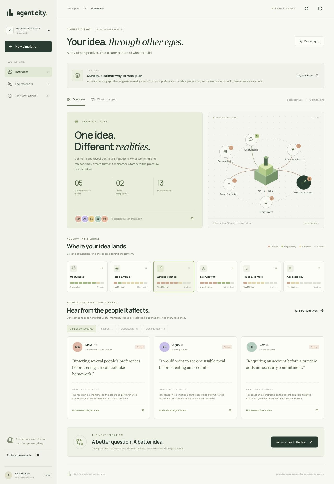

# Agent City

A visual idea stress test powered by eight fictional personalities. The report shows friction, opportunities, unknowns and disagreements across six dimensions. Drill into a finding to hear from a few distinct affected people, ask a focused follow-up, then revise and compare.



## Try the project

The screenshot above shows the illustrative example. A real, complete eight-person Qwen3 run is included in [docs/example-live-report.json](docs/example-live-report.json). These are simulated perspectives, not responses from real people.

Run the app locally for live analysis; the hosted preview is owner-private and is not a public live inference endpoint. A full eight-person evaluation can take approximately 6–9 minutes on the development Mac.

## Run locally

Requirements: Node.js 22.13+ and Ollama. The default model is the open-weight `qwen3:8b` (Apache 2.0 model license).

```sh
npm install
ollama pull qwen3:8b
# Start Ollama if it is not already running: ollama serve
npm run dev
```

Open http://localhost:5173. The installed local model is used automatically in development. The model is not bundled with this repository. The example report is deliberately labelled illustrative and is independent of live inference.

## How it works

- React / TypeScript UI with Vinext and Cloudflare Workers hosting support.
- Eight independent, sequential model calls; structured JSON schemas constrain outputs and server validation requires all six unique dimensions.
- Persona circumstances are defined in `lib/city.ts`. They are fictional and not samples of real demographic populations.
- Every assessment keeps its reason, assumption and proposed real-world experiment.
- Aggregation is deterministic: category counts retain all underlying assessments. There is no fabricated market score.
- Representative selection removes near-duplicate explanations using lexical overlap. This is a simple heuristic, not semantic clustering.
- Follow-up requests include the chosen persona, idea and original finding.
- Revision comparisons count friction only among personalities available in both runs. Model variation still affects comparisons.
- Reports are kept in browser localStorage (last 10) and exported as JSON. No cloud database stores pitches or reports.
- Cancel aborts outstanding model requests. Failed personalities are identified in a partial report; all failures preserve the previous report.

## Hosted inference

A private hosted preview can show the example without a model service. Production never reaches into the owner's localhost. For live hosted evaluation, configure server-side secrets through Sites:

- `MODEL_API_URL`: HTTPS OpenAI-compatible base URL ending in `/v1`
- `MODEL_NAME`: an available open-weight model that supports JSON-schema responses
- `MODEL_API_KEY`: provider key (never put it in frontend code)

Requests go to `${MODEL_API_URL}/chat/completions`. The server owns the endpoint; clients cannot supply arbitrary inference URLs. No key is needed for local Ollama.

For local runtime overrides, use an ignored `.dev.vars` file. Keep secrets out of Git. Model name and connection status are visible to the user; credentials are not.

## Checks

```sh
npx tsc --noEmit
node --experimental-strip-types --test tests/city.test.mjs
npm run build
```

Tests cover preservation of minority views, partial cohort counts, strict schema validation, identity provenance and representative deduplication. Manual browser QA covers report drill-down, submission, follow-ups, cancellation, saved reports and responsive layouts.

## Boundaries

This is a research-preparation tool, not actual user research or a forecast of demand. Unknown product details remain assumptions. Personality outputs may be wrong, inconsistent or biased; use the suggested experiments with real people. Scope is products and services.

Current constraints: a fixed eight-person panel, fixed six dimensions, a lexical representative-selection heuristic, and browser-scoped storage. Evaluation progress is tied to the open page; closing it interrupts the run. Hosting access is owner-private. The public source includes the UI, model orchestration, validation, tests and setup instructions.

## License

MIT for Agent City's original source. Dependencies and model weights retain their own licenses.

References: https://docs.ollama.com/capabilities/structured-outputs and https://ollama.com/library/qwen3:8b
